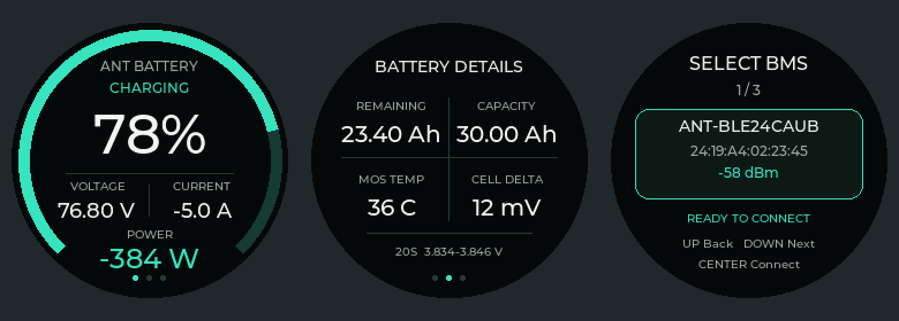

# 蚂蚁 BMS 圆屏 · ESP32-S3

基于 ESP32S3-N16R16-128SPIT 一体板的 Arduino 工程，通过 BLE 读取蚂蚁保护板数据，在 GC9A01 240×240 圆屏上显示电量、电压、电流、功率和电池详情。

当前版本：v0.11。采用 LVGL 8.3.11 黑底青绿界面，支持开机与连接后的电量加载动画、充电流光、蓝牙设备选择和自动重连；采用局部刷新，并修正顶部状态文字的刷新区域。当前硬件为无触摸版，使用三个侧键操作。

## UI 预览

以下为此前保存的 v0.7 UI 布局预览，依次展示首页、电池详情和蓝牙选择页；图中为示例数据，非实机截图。当前 v0.11 的加载动画及刷新区域调整未在这张静态图中体现。

## 快速开始

1. 下载并完整解压本仓库，或使用 `git clone https://github.com/ROCKBUND/ant-bms-display.git`。
2. 在 Arduino IDE 中安装 ESP32 开发板包 **3.3.10**，以及 **GFX Library for Arduino 1.6.9**、**NimBLE-Arduino 2.5.0**。
3. 打开 `AntRoundS3/AntRoundS3.ino`，保留同目录所有 `.h`、`.cpp` 和完整 `src/` 目录。LVGL 已内置，无需单独安装。
4. 按[工程说明](AntRoundS3/README.md)设置开发板、Flash、PSRAM 和 USB 选项。
5. 在 `AntRoundS3/Config.h` 中核对目标蓝牙名称和地址，或使用侧键进入蓝牙选择页选择自己的保护板。

## 侧键操作

| 按键 | 数据页面 | 蓝牙选择页面 |
|---|---|---|
| 上键 GPIO14 | 进入蓝牙选择 | 返回 |
| 中键 GPIO15 | 进入蓝牙选择 | 连接选中设备；无候选时重新扫描 |
| 下键 GPIO16 | 翻页 | 下一个设备 |

中键长按约 3 秒由硬件控制开关机。

## 源码和许可

- `AntRoundS3/`：完整 Arduino 工程及内置 LVGL 源码。
- [硬件、依赖与使用说明](AntRoundS3/README.md)。
- [第三方来源与许可证](AntRoundS3/THIRD_PARTY.md)。
- [历史源码检查记录](AntRoundS3/SOURCE_CHECKS.md)。
- [项目许可证](LICENSE)，第三方代码和字体保留各自许可证与版权声明。
